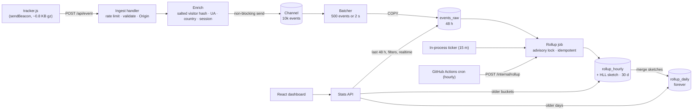

# Architecture

Kestrel is one Go binary, one Postgres database and a static React
dashboard. This page covers how data moves through the system and where
each responsibility lives. Why it is built this way is in
[decisions.md](decisions.md); measurements are in
[benchmarks.md](benchmarks.md).

## The whole system



## One pageview, step by step

```mermaid
sequenceDiagram
  participant B as Browser
  participant H as httpapi
  participant L as ratelimit
  participant C as site cache
  participant E as enrich + sessions
  participant Q as batch channel
  participant W as batcher
  participant DB as Postgres

  B->>H: POST /api/event (text/plain JSON, Origin)
  H->>L: allow(client IP /64)?
  H->>H: 4 KB cap, parse + normalise (ingest.Parse)
  H->>C: site for domain (1 min TTL)
  H->>H: Origin matches site domain?
  H->>L: allow(site)?
  H->>E: Enrich(site, ip, ua, now)
  Note over E: bot? → 202, dropped<br/>visitor = HMAC(daily salt, site‖ip‖ua)[:16]<br/>session = tracker.Assign(site, visitor, now)<br/>IP and UA are discarded here
  H->>Q: Enqueue (never blocks; full → drop + count)
  H-->>B: 202 Accepted   (p99 ≈ 2–8 ms)
  W->>Q: drain up to 500 / every 2 s
  W->>DB: COPY events_raw
```

Every response is `202` or an error, and none depend on the database. On a
warm path the handler does no I/O: the site cache, salt cache and session map
all live in memory.

## Read path

The stats service (`internal/stats`) decides where each query reads from:

| Request | Source |
|---------|--------|
| Range starting within the last 48 h | `events_raw` only, exact |
| Any filter (`page=`, `country=`...) | `events_raw` only; range clamped to 48 h |
| Range reaching further back | `rollup_daily` (or `rollup_hourly` for hourly series) up to the rollup frontier, plus `events_raw` for the rest |
| Realtime badge | `events_raw`, distinct visitors in the last 5 minutes |

A rolled-up range sums daily unique visitors across days; that is the only
honest number when visitor IDs rotate every day. Breakdowns merge the rollup
part and the raw part in Go, then take the top N.

## Background work

| Loop | Interval | What it does |
|------|----------|--------------|
| Batcher | 2 s or 500 events | Flushes the channel with `COPY` |
| Session eviction | 1 min | Drops sessions idle for 30 min or more |
| Rate-limiter sweep | 1 min | Drops fully refilled buckets |
| Rollup | 15 min, plus hourly cron | Rebuilds recent hours and their days from raw, merges sketches, then applies retention |

### Rollup run

1. Take `pg_try_advisory_lock`. If another run holds it, return `409` /
   skip.
2. Read `rollup_state`. Start 2 hours before `hourly_through` to pick up
   late flushes and sessions that were still open. On the very first run,
   start at the oldest raw event.
3. Load raw events from 3 hours before that start (session lookback) to now.
4. Aggregate per (site, local hour, dimension, value):
   - pageviews, plus a HyperLogLog sketch of visitors;
   - visits, bounces and duration, attributed to the hour each session
     started, under its entry page and entry source.
5. Cap each dimension at 50 values per bucket and fold the rest into
   `(other)`.
6. In one transaction:
   - replace the hourly rows in range;
   - rebuild the affected days by merging their hourly rows and sketches;
   - advance `rollup_state`.
7. Apply retention:
   - delete raw events older than 48 h, but never past the rollup frontier;
   - delete hourly rows older than 30 days;
   - delete salts older than 2 days.

`Backfill(site, from)` runs steps 3–6 for one site without moving the
frontier. Imports and the demo seeder use it.

## Package map

| Package | Role | Depends on |
|---------|------|-----------|
| `cmd/server` | Wiring, config, graceful shutdown (HTTP → drain batcher) | everything |
| `cmd/seed` | Demo traffic generator + backfill | batch, rollup, store, auth |
| `internal/httpapi` | Routing, middleware, handlers; thin | stats, enrich, batch, rollup, ratelimit |
| `internal/ingest` | Payload validation and URL normalisation (pure) | sites |
| `internal/enrich` | Salts, visitor hash, UA, GeoIP, session assignment | sessions, store |
| `internal/sessions` | In-memory session tracker with injectable clock | — |
| `internal/batch` | Channel, batcher, `COPY` writer | store, metrics |
| `internal/rollup` | Aggregation, `(other)` capping, job, backfill, retention | hll, store, metrics |
| `internal/hll` | HyperLogLog sketch, sparse and dense encodings | — |
| `internal/stats` | Query planning (raw vs rollups) and read model | rollup, store |
| `internal/ratelimit` | Token buckets | — |
| `internal/metrics` | Prometheus collectors | — |
| `internal/store` | sqlc-generated queries (do not edit) | — |
| `web/` | React + TanStack Query + Recharts + Tailwind | `/api` |

## Data model

| Table | Holds | Retention |
|-------|-------|-----------|
| `users`, `sessions` | Accounts and dashboard login sessions (hashed tokens) | Until deleted / expired |
| `sites` | Registered domains, optional `public_slug` | Until deleted |
| `salts` | One random salt per UTC day | 2 days |
| `events_raw` | One row per event, enriched, no IP/UA | 48 hours |
| `rollup_hourly` | (site, local hour, dimension, value) → counts + HLL sketch | 30 days |
| `rollup_daily` | (site, local day, dimension, value) → counts + visitor estimate | Forever |
| `rollup_state` | How far the rollup job has got | Single row |

Dimensions are `_total`, `page`, `referrer`, `country`, `browser`, `os`,
`device` and `event`.

## Scaling out (not built)

The service assumes one instance. Three things are per-process:

- the session map;
- the rate-limit buckets;
- the site cache.

To run several instances:

- move sessions and rate limits to Redis;
- keep one batcher per instance (each flushes its own buffer);
- rely on the advisory lock that already makes the rollup job safe to run
  from many places.

The ingest handler is otherwise stateless.
